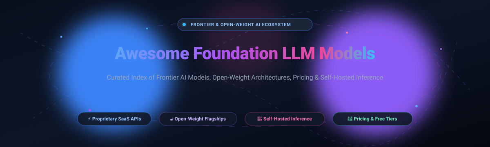

# Awesome Foundation LLM Models 🤖

  

  
  
  
  
  
  

---

## 🌟 Top Foundation LLM Models Ecosystem

**A Curated List of SaaS Platforms & Open-Source GitHub Projects for Frontier Model Access, Open-Weight Architectures & Self-Hosted Inference** 🚀

*Last updated: October 2026* 📅

Welcome to the definitive, SEO-optimized knowledge repository tracking notable **SaaS platforms**, **developer APIs**, and **open-source GitHub projects** powering the **Foundation Large Language Model (LLM)** landscape. Whether you are building autonomous AI agents, deploying enterprise RAG pipelines, or self-hosting open-weight architectures on dedicated GPU clusters, this catalog provides vetted technical specifications, starting pricing, free tier quotas, company valuations, and GitHub star metrics.

**Key Highlights:**
- 🏢 **Frontier SaaS APIs & Proprietary Platforms:** OpenAI GPT-5, Anthropic Claude Opus 4.7, Google Gemini 3 Deep Think, Microsoft Copilot, AWS Bedrock, Mistral Large 3, Cohere Command A, AI21 Jamba2, Perplexity Pro, and Grok 4.5.
- 🔓 **Open-Weight Flagships & Self-Hosted Models:** DeepSeek-V3 / R1, Meta Llama, Mistral AI, Qwen 2.5 / 3, State Spaces Mamba, Allen AI OLMo, Tsinghua GLM-4, 01-AI Yi, and Google DeepMind Gemma.

---

## 📑 Table of Contents
- [📊 Sector Overview & Market Dynamics](#-sector-overview--market-dynamics)
- [🏢 SaaS & Hosted Platforms](#-saas--hosted-platforms)
- [🔓 Open-Source GitHub Projects](#-open-source-github-projects)
- [🤝 How to Contribute](#-how-to-contribute)
- [💖 Support](#-support)
- [⚠️ Disclaimer](#-disclaimer)
- [📈 Star History](#-star-history)

---

## 📊 Sector Overview & Market Dynamics

The global foundation model and generative AI market is estimated at **$67 billion in 2026** and projected to surpass **$350 billion by 2032**, expanding at a compound annual growth rate (CAGR) exceeding 32%. The foundation LLM sector exhibits **moderate-to-high concentration with strong platform power dynamics** (an oligopolistic tier led by hyperscalers Microsoft, Alphabet, Amazon, and frontier labs OpenAI and Anthropic), yet remains resiliently contested against absolute "winner-take-all" capture due to aggressive open-weight commoditization (e.g., DeepSeek, Meta Llama, Alibaba Qwen) and enterprise demands for data sovereignty, multi-cloud redundancy, and cost control.

---

## 🏢 SaaS & Hosted Platforms

The following SaaS and API platforms provide hosted, frontier foundation LLM access. Entries are ranked in descending order by parent company scale (market capitalization or private valuation).

| Platform / Model | Company Scale (Valuation / Market Cap) | Description | Starting Tier Pricing | Free Tier Limits |
| :--- | :--- | :--- | :--- | :--- |
| **[Microsoft Copilot](https://copilot.microsoft.com/)** | **~$3.2 Trillion** *(Market Cap)* | Microsoft's enterprise-grade AI assistant built on OpenAI models, integrated across Microsoft 365, Windows, and Edge with commercial data protection. | Consumer/Pro: $19.99/mo (Microsoft 365 Premium / Copilot Pro) or $30/user/mo (M365 Copilot Enterprise) | Free forever plan: Unlimited basic chat and search grounding on web/mobile/Edge; capped at 15 DALL-E / Designer fast image boosts per day; no M365 desktop app integration. |
| **[Google Gemini 3 Deep Think](https://deepmind.google/technologies/gemini/)** | **~$2.1 Trillion** *(Alphabet Market Cap)* | Google's specialized reasoning mode for scientific and engineering problem solving with native multimodality and live code execution. | Consumer: $19.99/mo (Google AI Pro); API starting at $1.25 / 1M input tokens, $5.00 / 1M output tokens (Gemini Pro/Flash variants) | Free forever plan: Full access to Gemini base web app with up to 60 queries/hour on standard models; Google AI Studio API free tier allows 15 RPM (requests per min), 1M TPM, and 1,500 requests/day. |
| **[AWS Bedrock](https://aws.amazon.com/bedrock/)** | **~$2.0 Trillion** *(Amazon Market Cap)* | Fully managed AWS service offering unified API access to foundation models from Anthropic, Meta, Mistral, Cohere, AI21, and Amazon Titan. | Pay-as-you-go starting at $0.00015 / 1K input tokens ($0.15 / 1M tokens on Amazon Nova Micro) | Free trial plan: No permanent free tier; new AWS accounts receive a $200 promotional credit valid for up to 6 months (180 days) applicable across Bedrock foundation model inference. |
| **[OpenAI GPT-5](https://openai.com/)** | **~$157 Billion** *(Private Valuation)* | OpenAI's flagship multimodal model family with automatic routing between fast and deep reasoning modes, 1M context window in Thinking variants, and built-in computer use. | Consumer: $20/mo (ChatGPT Plus); API starting at $1.25 / 1M input tokens, $10.00 / 1M output tokens (GPT-5 series) | Free forever plan: Unlimited standard text chats (dynamic model fallback); rolling quota of up to 10-16 messages per 3 hours on advanced models, limited web search, file analysis, and 2 image generations per day. |
| **[Anthropic Claude Opus 4.7](https://www.anthropic.com/)** | **~$60 Billion** *(Private Valuation)* | Anthropic's flagship model specialized for complex reasoning, agentic coding, computer use, and long-form analysis with 1M context beta support. | Consumer: $20/mo (Claude Pro); API starting at $5.00 / 1M input tokens, $25.00 / 1M output tokens (Opus series) | Free forever plan: Dynamic message quota (typically ~10–30 messages per 5-hour rolling window depending on demand and prompt length) using standard Claude models; 5 artifacts/projects max. |
| **[Grok 4.5](https://x.ai/)** | **~$45 Billion** *(xAI Valuation)* | xAI's flagship model featuring 500K context, multimodal vision, real-time X data access, and deep reasoning capabilities. | Consumer: $8/mo (X Basic/Plus) or $30/mo (X Premium+); API pay-as-you-go starting at $2.00 / 1M input tokens, $6.00 / 1M output tokens | Free forever plan: Free web/mobile chat with dynamic quota (typically 10-20 queries per 2 hours on Grok 2/3 variants); API console grants a one-time $25 promotional credit valid for 30 days upon registration. |
| **[Perplexity Pro](https://www.perplexity.ai/)** | **~$9 Billion** *(Private Valuation)* | AI-powered conversational search engine providing real-time web citations, multi-file uploads, and multi-model access across leading frontier LLMs. | Pro plan: $20/mo (or $200/year billed annually) | Free forever plan: Unlimited standard search queries; 3 Pro Searches (deep research / multi-step reasoning) every 24 hours; 1 Deep Research query per month; up to 3 file uploads/day. |
| **[Mistral Large 3 (API)](https://mistral.ai/)** | **~$6 Billion** *(Private Valuation)* | Mistral's 675B parameter flagship model available via La Plateforme API and NVIDIA NIM, optimized for FP8/NVFP4 inference with 256K context. | Pay-as-you-go starting at $2.00 / 1M input tokens, $6.00 / 1M output tokens (Mistral Large) | Free forever plan: "Experiment" evaluation tier on La Plateforme with $0 payment required; strictly rate-limited to 1 request per second (RPS) and up to ~1B monthly tokens across evaluation endpoints. |
| **[Cohere Command A](https://cohere.com/)** | **~$5.5 Billion** *(Private Valuation)* | Cohere's 111B parameter enterprise model family built for multi-step agentic workflows, multilingual reasoning (23 languages), and grounded citations. | Pay-as-you-go starting at $0.40 / 1M input tokens, $1.60 / 1M output tokens (Command A) | Free forever plan: Evaluation Trial Key provides up to 1,000 API calls per month total across all endpoints, capped at 20 requests per minute (RPM) for Command chat models (strictly non-production). |
| **[AI21 Labs Jamba](https://www.ai21.com/)** | **~$1.4 Billion** *(Private Valuation)* | Hybrid SSM-Transformer architecture with 256K context, offering Jamba Mini ($0.20/$0.40 per 1M tokens) and Jamba Large ($2.00/$8.00 per 1M tokens). | Pay-as-you-go starting at $0.20 / 1M input tokens, $0.40 / 1M output tokens (Jamba Mini) | Free trial plan: $10.00 USD in free platform credits upon account creation, valid for 90 days (3 months) without requiring a credit card. |

---

## 🔓 Open-Source GitHub Projects

Curated list of leading open-weight LLM repositories, model weights, and foundation frameworks for self-hosting, fine-tuning, and inference. Ranked in descending order by GitHub stargazers count, with real-time star badges linking directly to each repository's stargazers page.

- **[DeepSeek-V3](https://github.com/deepseek-ai/DeepSeek-V3)**  🧠  
  DeepSeek's flagship Mixture-of-Experts (MoE) foundation model with 671B total parameters (37B activated per token) and multi-head latent attention (MLA). Delivers frontier-level performance at a fraction of pre-training and inference compute costs. MIT licensed.

- **[DeepSeek-R1](https://github.com/deepseek-ai/DeepSeek-R1)**  🔬  
  Breakthrough open-weight reasoning model developed with pure reinforcement learning (RL) without supervised fine-tuning (SFT) cold starts. Demonstrates math, coding, and logical reasoning comparable to OpenAI o1/o3, with full distillation releases across Qwen and Llama architectures. MIT licensed.

- **[Meta Llama](https://github.com/facebookresearch/llama)**  🦙  
  Meta's foundational open-weight language model repository that revolutionized open AI research. Accompanies the ongoing **[Meta Llama Models Ecosystem](https://github.com/meta-llama/llama-models)**  featuring Llama 3 and Llama 4 MoE architectures with native multimodality, 1M context windows, and tool-use capabilities under the Llama Community License.

- **[Qwen 2.5 / Qwen 3](https://github.com/QwenLM/Qwen2.5)**  🌐  
  Alibaba Cloud's comprehensive open-weight LLM suite spanning 0.5B to 72B dense parameters, plus MoE variants. Renowned for superior multilingual performance (covering 29+ languages), 128K context length, coding synthesis, and mathematical problem-solving. Apache 2.0 licensed.

- **[State Spaces Mamba](https://github.com/state-spaces/mamba)**  ⚡  
  Pioneering linear-time sequence modeling architecture based on selective state space models (SSMs). Eliminates quadratic attention bottlenecks, enabling extreme context throughput and efficient inference on long document streams, forming the backbone for hybrid LLMs like AI21 Jamba. Apache 2.0 licensed.

- **[Mistral Source & Inference](https://github.com/mistralai/mistral-src)**  🌪️  
  Reference implementations and open-weight checkpoints for Mistral AI's high-efficiency models, including Mistral 7B, Mixtral 8x7B/8x22B MoE, and Mistral Large 3 (675B parameters). Optimized for vLLM, TensorRT-LLM, and NVIDIA NIM deployment with native function calling and Apache 2.0 licensing.

- **[01-AI Yi](https://github.com/01-ai/Yi)**  💡  
  01.AI's open-source bilingual (English/Chinese) foundation model series spanning 6B, 9B, and 34B parameter sizes. Designed from ground up with 200K native context support and industry-leading performance on general knowledge benchmarks. Apache 2.0 licensed.

- **[EleutherAI GPT-NeoX](https://github.com/EleutherAI/gpt-neox)**  🧪  
  Flagship distributed GPU pre-training and fine-tuning library for autoregressive language models built on Megatron-LM and DeepSpeed. Powers fully transparent open-source research and base models like Pythia. Apache 2.0 licensed.

- **[InternLM](https://github.com/InternLM/InternLM)**  🎓  
  Shanghai AI Laboratory's open-source foundation model family supporting up to 1M token contexts, mathematical reasoning, agent tool invocation, and complete end-to-end training toolkits from pre-training to RLHF. Apache 2.0 licensed.

- **[THUDM GLM-4](https://github.com/THUDM/GLM-4)**  🇨🇳  
  Tsinghua University and Zhipu AI's flagship open bilingual model series (GLM-4-9B, GLM-4V). Features 128K context, high-speed multi-turn dialogue, web browsing, code execution, and vision understanding. Open weights under the GLM License.

- **[Allen AI OLMo](https://github.com/allenai/OLMo)**  📚  
  Truly open foundation model family providing open weights, training code, evaluation metrics, pre-training datasets (Dolma), and intermediate training logs. Built by AI2 to advance transparent scientific study of language models. Apache 2.0 licensed.

- **[Google DeepMind Gemma](https://github.com/google-deepmind/gemma)**  💎  
  Google's family of lightweight, state-of-the-art open models built from the same research and technology used to create Gemini. Features 2B, 7B, 9B, and 27B dense variants, plus Gemma 3 / 4 edge architectures optimized for LiteRT-LM, JAX, PyTorch, and Hugging Face. Gemma Terms of Use.

- **[Salesforce CodeGen](https://github.com/salesforce/CodeGen)**  💻  
  Salesforce Research's family of foundation models trained for multi-turn program synthesis, code generation, and Conversational Programming across Python, Java, C++, and Go. BSD-3-Clause licensed.

- **[Microsoft Phi CookBook & Small Language Models](https://github.com/microsoft/Phi-3CookBook)**  📐  
  Official developer guide, recipes, and deployment architecture for Microsoft's Phi-3 and Phi-4 small language models (SLMs). Delivers remarkable mathematical, coding, and logical reasoning at compact footprint sizes (3.8B to 14B) for local PC and edge hardware. MIT licensed.

- **[BigCode StarCoder2](https://github.com/bigcode-project/starcoder2)**  ⭐  
  Transparent code LLMs (3B, 7B, and 15B parameter models) developed by BigCode community trained on The Stack v2 across 600+ programming languages. Provides ethically sourced, fully audited training data pipelines under BigCode OpenRAIL-M v1 license.

---

## 🤝 How to Contribute

Contributions are warmly welcomed! Help keep this foundation model index up-to-date with new frontier releases:

1. 🍴 **Fork** this repository.
2. 🌿 **Create a new branch** (`git checkout -b feature/add-new-model`).
3. ✍️ **Add or update entries** in `README.md` following the existing tabular or open-source list format (provide factual parameters, official docs/repo links, starting pricing, and exact free tier terms).
4. 📬 **Submit a Pull Request** with a concise summary of changes.

⭐ **Don't forget to star the repo if you find it helpful!**

---

## 💖 Support

A huge thank you to everyone exploring, using, and contributing to this curated index! 🌟

If you find this repository valuable for your research, team, or production stacks, please consider supporting the project:
- ⭐ **Star** this repository to help boost discoverability on GitHub.
- 🍴 **Fork** and share it with your fellow engineers, researchers, and AI communities.
- ☕ **Buy me a coffee / Sponsor the project**: Support ongoing maintenance and curation via the [GitHub Sponsors Dashboard](https://github.com/sponsors/ishandutta2).

---

## ⚠️ Disclaimer

- This repository is a **community-curated index** for informational and educational purposes; inclusion does not constitute commercial endorsement.
- "Open-source" in the foundation LLM sphere predominantly refers to **open weights**, rather than OSI-approved open source, as complete pre-training datasets and recipes are seldom shared in full.
- Always review individual license agreements (Apache 2.0, MIT, Llama Community License, Gemma Terms) prior to commercial deployment.

---

## 📈 Star History

---

  <b>Built for AI Engineers, ML Researchers, Systems Architects, and Foundational AI Teams worldwide.</b> 🌍 
  <i>Advancing transparency, open weights, and accessible frontier intelligence.</i>

